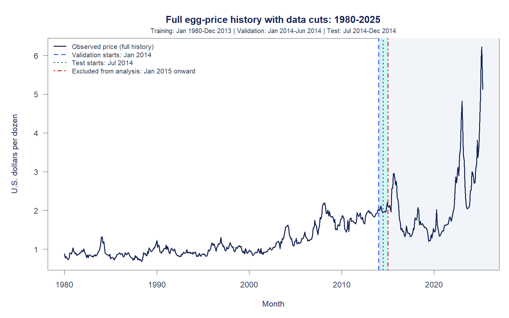

# Egg-onomics: revised 2014 study

This is the current working folder. Keep this file updated as the plan, code,
results or report changes. Last updated: **24 October 2026**.

## Final two-model design (use this for the report)

The team's final design. It replaces the 6+6 plan below for report and slide
work. The older code, results and alternative designs are kept unchanged for
the record.

| Use | Dates | Months |
| --- | --- | ---: |
| Training | January 1980-December 2013 | 408 |
| Test (no validation set) | January-December 2014, all from the Dec 2013 origin | 12 |
| Final refit of the better model | January 1980-December 2014 | 420 |
| Post-hoc comparison only | January 2015-April 2025 | 124 |

- **Two models, original dollar prices, no transform:** Damped Holt,
  ETS(A,Ad,N); and Seasonal ARIMA from a seasonal `auto.arima` search on the
  training data, which gives ARIMA(1,1,0)(2,0,0)[12]. The order is fixed from
  that search and only the coefficients are re-estimated in the final refit.
- **Choice rule:** lower 2014 test RMSE. Ties (RMSEs equal to $0.001) go to the
  lower MAE, then to the smaller absolute ME.
- **Result (23 October 2026 run):** Seasonal ARIMA, test RMSE $0.0721 against
  $0.0753 for Damped Holt. Seasonal ARIMA wins on MAE, RMSE, MAPE and MASE;
  Damped Holt has the smaller mean error.
- **Forecasts:** better model only, refit through December 2014, for 6, 12 and
  144 months (January 2015-December 2026). The PDF's Task 5 asks for "about 10
  time steps", which is answered by the 12-month forecast. The 144-month
  forecast is an extra; only its first 124 months have actual prices to compare
  against, and months 125-144 are left unscored.
- **Leakage:** no post-2014 price is used for fitting, choosing or test
  scoring. `leakage_checks.csv` records 9 checks, all passed.
- **Gap framing:** the post-hoc gap is the forecast error of a pre-2015 model.
  It is not a "prices without the flu" estimate. The signed error runs both
  ways (below the projection in 2016-2021, above it in 2022-2025), so the gap
  RMSE is not a "cost of the shocks".

Run it from this folder. It takes about 1 minute and needs the `forecast`
package. Install it once with `install.packages("forecast")`:

```text
Rscript analysis/final_two_models.R
```

or, in RStudio with `egg-onomics.Rproj` open:

```r
source("analysis/final_two_models.R")
```

All outputs go to `results/final_two_models/`. `results.txt` prints every key
table on one page, and `file_guide.csv` maps each file to the PDF task it
supports. Reusable fitting, scoring, plotting and inflation functions are in
`analysis/final_helpers.R`. The final study no longer loads the older
`analysis/helpers.R` or changes `EGG_FORECAST_OUTPUT`. `EGG_DATA_FILE` can
override the input file and `EGG_FINAL_OUTPUT` can override the output folder.
The older `analysis/forecast.R` and its helpers remain available for the record.
`GUIDE_FOR_REPORT_AND_SLIDES.md` gives hints for the report and the individual
slides. It contains no report text and no slide text, because the team must
write those.

### Report-ready outputs added 24 October 2026

- `figures/13_final_forecast_2015.png` and `report_final_forecast_2015.csv`
  identify the main Task 5 forecast: Jan-Dec 2015 from the Dec 2014 origin,
  with 80%/95% prediction intervals and no later actual prices. The forecast
  is the existing 12-month path, not a new model or fitting procedure.
- `report_model_parameters.csv` contains the key coefficients and meanings
  for both test fits and the selected model's final refit, with fitting dates.
- `inflation_comparison.csv` and `figures/14_inflation_comparison.png` compare
  the 1980 average actual price ($0.843833) with the 2026 average forecast
  ($2.336812). `data/inflation_benchmarks.csv` records the CPI-U all-items
  series, values, periods, source links and retrieval date. The 1980 annual
  CPI is 82.4; the Sep 2026 monthly benchmark is 336.940. The adjusted 1980
  price is $3.450500, making the forecast 32.28% lower. This is provisional:
  a monthly CPI benchmark is not the completed annual average for 2026,
  and the 2026 egg price is a forecast. CPI is never used to fit or choose a model.

The Google Doc report uses the main 2015 forecast separately from the 2014
test forecast and the additional 12-year projection. The two-model design,
existing forecasts and 2014 scores remain unchanged.

## Earlier plan: 6+6 design (superseded by the final two-model design above)

Use data before 2014 for training, then split 2014 into two six-month periods.

| Use | Dates | Months |
| --- | --- | ---: |
| Training | January 1980-December 2013 | 408 |
| Validation | January-June 2014 | 6 |
| Test | July-December 2014 | 6 |
| Excluded from fitting and scoring | January 2015-April 2025 | 124 |

The source still contains all 544 monthly observations from January 1980 to
April 2025. Only the first 420 enter the analysis. No values are filled or
interpolated. January 2015 is the chosen cutoff, not a date estimated by a model.

Keep **one full 1980-2025 history graph** with vertical lines at January 2014,
July 2014 and January 2015. Later prices stay visible for context. Do not create
a separate zoomed data-split graph.



## Run the earlier 6+6 analysis (historical)

Open `egg-onomics.Rproj` in RStudio. Install the two R packages once if needed:

```r
install.packages(c("forecast", "jsonlite"))
```

Run the complete analysis:

```r
source("analysis/forecast.R")
```

Or, from this folder in a terminal:

```text
Rscript analysis/forecast.R
```

To update only the history graph and data-split metadata:

```r
Sys.setenv(EGG_PLOTS_ONLY = "1")
source("analysis/forecast.R")
Sys.unsetenv("EGG_PLOTS_ONLY")
```

The plot-only option does not refit models or rebuild the full results viewer.
Run the complete analysis after changing modeling settings or evaluation dates.
`EGG_DATA_FILE` and `EGG_FORECAST_OUTPUT` are optional overrides; leave them unset
to use this folder's own data and results.

## Folder guide

| File or folder | Purpose |
| --- | --- |
| `README.md` | Main plan, current status and work log |
| `egg-onomics.Rproj` | RStudio project |
| `analysis/forecast.R` | Import, splits, all nine models, evaluation and plots |
| `analysis/helpers.R` | Helpers for the earlier nine-model study |
| `analysis/viewer.R` | Builds the HTML results viewer |
| `data/APU0000708111.csv` | Original full input, kept unchanged |
| `results/index.html` | Earlier 6+6 study viewer |
| `results/figures/00_history.png` | The single full-history data-cut graph |
| `results/data_splits.csv` | Exact training, validation and test dates |
| `results/plot_cut_dates.csv` | The three vertical cut-line dates |
| `results/monthly_calendar.csv` | The 420 observations used by the analysis |
| `results/full_monthly_calendar.csv` | All 544 observations retained for context |
| `results/validation_accuracy.csv`, `results/test_accuracy.csv` | Current model comparisons |
| `results/evaluation_predictions.csv` | 108 predictions: nine models, two six-month windows |
| `results/forecast_6_months_all_models.csv` | January-June 2015 projections and intervals |
| `results/forecast_12_months_all_models.csv` | January-December 2015 projections and intervals (added) |
| `results/projection_2015_2025_all_models.csv` | 124-month projection, January 2015-April 2025 (added) |
| `results/gap_vs_actual_by_month.csv`, `results/gap_vs_actual_summary.csv` | Post-hoc projection-vs-actual gap, by month and summarised over 6 months, 12 months and the full period (added) |
| `results/figures/05_projection_selected.png`, `06_projection_auto_ets.png` | Long projection vs actual prices (added) |
| `results/fitted_models.rds` | Saved models |
| `results/session_info.txt` | R and package versions from the last full run |
| `MANIFEST.csv` | SHA-256 hashes and sizes of the packaged files |
| `analysis/final_two_models.R` | **Final design:** Damped Holt vs Seasonal ARIMA, 2014 test, 6/12/144-month forecasts, post-hoc gap |
| `analysis/final_helpers.R` | Final-study fitting, scoring, plotting, inflation calculation and output catalog |
| `results/final_two_models/` | **Final design outputs:** tables, `results.txt`, `file_guide.csv` and 19 figures |
| `GUIDE_FOR_REPORT_AND_SLIDES.md` | Hints, numbers, traps and checklist for the team's own report and slides (no draft text) |
| `analysis/one_year_test.R`, `results/one_year_test/` | Earlier alternative: nine models, one 12-month test in 2014 |
| `analysis/val_test_12m.R`, `results/val_test_12m/` | Earlier alternative: 2013 validation, 2014 test |

## Earlier 6+6 results and status (kept for the record)

- All nine R methods have been run on the revised split: SES, Holt, Damped Holt,
  Holt-Winters, Auto ETS, Naive, Seasonal naive, ARIMA and Seasonal ARIMA search.
- All models now work on original dollar prices (the earlier log/bias-adjusted
  setup was removed; see the 23 October work log). Naive has the lowest
  validation RMSE, **$0.054721 per dozen**; ARIMA, Damped Holt and SES are within 0.2%.
- The validation-selected Naive model has test RMSE **$0.113400**. Auto ETS has
  the lowest observed test RMSE, **$0.062112**, then Seasonal ARIMA **$0.069658**. That test ranking does not
  replace the validation choice.
- The January-June 2015 forecasts are saved projections only. Actual prices from
  those months are not used in fitting, selection or scoring.
- Split checks confirm 408/6/6 months. The original source-file MD5 is
  `bf246189cbf9d52a5da338e57f838d30`.
- The full-history graph and its three cut lines have been visually checked.
- Packaging checks passed: a complete run from the new folder, a detached
  plot-only run outside the old repository, and validation of source hashes,
  split dates, prediction counts and plot references.

### Claims and gap analysis (added)

- **Claim 1, stable-regime study:** how well standard methods do when fitted and
  scored on the calmer pre-2015 regime only.
- **Claim 3, cost of the shocks:** the gap between the pre-2015 projections and
  the actual 2015-2025 prices is the forecast error of a pre-2015 model. It
  includes avian flu outbreaks *and* other changes (inflation, feed costs,
  cage-free rules).
- *Note added with the final design:* "cost of the shocks" is only a label. The
  signed gap changes direction over 2015-2025, so its RMSE measures how far the
  baseline missed in both directions, not a cost caused by any one shock.
- **Not claimed:** "this is what prices would have been without the flu". That
  is causal and assumes nothing else changed; the projection is only a baseline
  scenario with a widening interval.
- Actual post-2014 prices are used only in the gap files and plots, after the
  fact. Fitting, selection and the validation/test scores still end in
  December 2014.
- Gap results (dollar models): 6-month RMSE about $0.20-0.26 (models nearly tied,
  Naive $0.20); 12-month $0.43-0.59; full 124 months $0.92-0.99, with every model
  missing the 2022-2025 spikes. Full-period 95% coverage ranges from 57% to 80%.
- Caveats: six months in one calm year is a thin evaluation sample, and pre-2015
  is calmer rather than spike-free. A rolling-origin check was considered and
  skipped as overkill.

The earlier neural-network, foundation-model and outbreak-comparison experiments
are outside this folder. Their settings, dates and scores do not describe this
revised study.

## Report

The [Google Docs report](https://docs.google.com/document/d/1Ww4--ggtK9WUdG6Yw6T0TQmVG8rBN-eF-vWENc38lqg/edit)
has been pruned. Use the final two-model design and `results/final_two_models/`
for subsequent report work, and preserve the user's current report edits. Packaging this folder does
not change the online report.

## Work log

### 23 October 2026

- Changed the study to training before 2014, validation in the first six months
  of 2014, and testing in the last six months of 2014.
- Kept all source observations, but excluded post-2014 actuals from modeling.
- Put the three cut lines directly on the full 1980-2025 graph and removed the
  separate zoomed graph.
- Re-ran all nine R methods for the revised six-month windows.
- Packaged the current code, input and results in this self-contained folder.
  This README is now the main project note for further work.

### 23 October 2026 (addition by M4 + Claude: longer horizons and gap analysis)

- Added to `analysis/forecast.R`, after the six-month forecast: a 12-month
  forecast (Jan-Dec 2015) and a long projection (Jan 2015-Apr 2025, 124 months)
  for all nine models, refit-free except Naive/Seasonal naive, whose horizon is
  fixed at fit time. Splits, models, selection and the six-month results are unchanged.
- New files: `forecast_12_months_all_models.csv`, `projection_2015_2025_all_models.csv`,
  `gap_vs_actual_by_month.csv`, `gap_vs_actual_summary.csv`,
  `figures/05_projection_selected.png`, `figures/06_projection_naive.png`.
- Gap analysis compares each projection with the actual post-2014 prices
  (error, % error, 80%/95% coverage; 6 months, 12 months, full period). Actuals are
  used only for this after-the-fact comparison, never for fitting, selection or scoring.
- Interpretation: the gap is forecast error of a pre-2015 model. It includes avian
  flu outbreaks and other changes (inflation, feed costs, cage-free rules). It is
  not an estimate of what prices would have been without the flu.

### 23 October 2026 (addition by M4 + Claude: Chronos-2 comparison in `tsfm/`)

- `tsfm/chronos_forecast.py` runs zero-shot Chronos-2 (no fine-tuning, no tuning, dollar prices)
  on the same origins: Dec 2013 (validation, h=6), Jun 2014 (test, h=6) and Dec 2014
  (h=124; its first 6 and 12 months are the 6- and 12-month forecasts). Contexts end at
  each origin; post-2014 prices appear only in the gap table. `tsfm/chronos_plot.py`
  draws the projection. Outputs are in `tsfm/results/`. The point forecast is the
  median of its dollar-scale forecast. Chronos also works on dollars, like the R models.
- Chronos was not part of the validation selection among the nine R models.

### 23 October 2026 (change by M4 + Claude: removed log transform)

- Removed `lambda = 0` and `biasadj` from every R model (`helpers.R`, `forecast.R`)
  and switched the training ACF/STL exploration and residual diagnostics to
  dollars. Reason: prices stayed between $0.68 and $2.20 before 2015 and are
  always positive, and one scale for all nine models makes the comparison
  like-for-like (Naive was already on dollars).
- Known trade-off: the monthly dollar change sd rose from 0.059 (1980s) to 0.104
  (2010s) while the log change sd stayed about 0.062, so dollar intervals are too
  narrow at 2014 price levels.
- Holt-Winters kept with the default optimiser. An `admissible`-bounds refit fits
  much better in sample but does not forecast better, so it is only a footnote.
- Effect: validation selection is still Naive; test ranking changed (Auto ETS now best).
  Fitted structures changed for ARIMA (1,1,0 instead of 3,1,3 with drift).

### 23 October 2026 (addition by M4 + Claude: one-year test alternative)

- Quick alternative to the 6+6 split: no validation window, a single 12-month test
  (Jan-Dec 2014) with models fitted through Dec 2013. `analysis/one_year_test.R`
  (nine R models) and `tsfm/chronos_one_year.py` (Chronos-2) write
  `results/one_year_test/`. The main 6+6 study is unchanged.

### 23 October 2026 (addition by M4 + Claude: 12-month validation and 12-month test)

- Second alternative design: validation Jan-Dec 2013 (fit through Dec 2012) and
  test Jan-Dec 2014 (refit through Dec 2013). `analysis/val_test_12m.R` and
  `tsfm/chronos_val_test_12m.py` write `results/val_test_12m/`. The 6+6 study is unchanged.

### 23 October 2026 (addition by M4 + Claude: final two-model design)

- Team decision: two models only (Damped Holt, Seasonal ARIMA); no validation
  set; train Jan 1980-Dec 2013; test Jan-Dec 2014; better model by test RMSE
  with a stated tie rule; refit through Dec 2014; forecast 6, 12 and 144 months;
  post-hoc gap scored on the 124 months with actuals. Chronos, the other seven
  models and the 6+6 split are not part of this design.
- New `analysis/final_two_models.R` writes `results/final_two_models/`. Nothing
  else in the folder was changed: `forecast.R`, `helpers.R` and all older
  results were left as they were.
- Result: Seasonal ARIMA chosen (2014 test RMSE 0.0721 against 0.0753). Gap RMSE
  0.204 over 6 months, 0.475 over 12 and 0.974 over 124. These are the same
  numbers as the "Seasonal ARIMA search" rows of `results/gap_vs_actual_summary.csv`.
- Points to know (details in `GUIDE_FOR_REPORT_AND_SLIDES.md`):
  - The pair was picked after nine-model 2014 results had been seen.
  - The 2013 check ranks the two models the same way as 2014; the ranking flip
    is between the two halves of 2014.
  - Damped Holt's beta is at its lower bound, so it behaves like simple
    exponential smoothing.
  - Both models fail Ljung-Box at 5%.
  - The 95% lower bound stays above $0 through Dec 2026 (lowest $0.015).
  - Seasonal ARIMA is not in the PDF's example list of methods.
- Added `GUIDE_FOR_REPORT_AND_SLIDES.md` (hints only; no report or slide text).

### 24 October 2026 (report requirements and reproducible inflation comparison)

- Added a clearly named main 2015 forecast figure/table, compact parameter
  export and source-recorded inflation comparison to `analysis/final_two_models.R`.
- Corrected the file guide to show 20 unscored long-forecast months (125-144).
- Full R rerun passed. Existing accuracy, monthly predictions, 144-month
  forecasts, fitted parameter tables and all 9 leakage checks match the
  preceding outputs exactly. STL exploration values differ only at floating-point precision.
- Updated the report with the main forecast, parameter explanations, figure
  captions, practical conclusions and corrections to superseded definitions.

### 24 October 2026 (R code cleanup)

- Split reusable functions into `analysis/final_helpers.R`, leaving the main
  script as the study workflow. The final script now needs only `forecast`
  and does not load the older nine-model helpers or change the caller's
  output environment variable.
- Made forecast-plot inputs and the MASE scale explicit, replaced the
  residual-summary `<<-` side effect with a returned table, and grouped each
  output filename with its description and task in one catalog.
- Applied consistent R formatting and section headings. The dates, models,
  choice rule, output filenames and plot styling are unchanged.
- Verified a full run from outside the project directory: all 22 CSV tables
  match the prior results numerically (STL values checked to 1e-12), all 19
  PNG graphs are byte-for-byte identical, and all 9 leakage checks pass.
  The caller's `EGG_FORECAST_OUTPUT` value is preserved.
